<div align="center">

<picture>
  <source media="(max-width: 600px) and (prefers-color-scheme: dark)" srcset="docs/brand/readme-banner-dark-mobile.svg">
  <source media="(max-width: 600px)" srcset="docs/brand/readme-banner-light-mobile.svg">
  <source media="(prefers-color-scheme: dark)" srcset="docs/brand/readme-banner-dark.svg">
  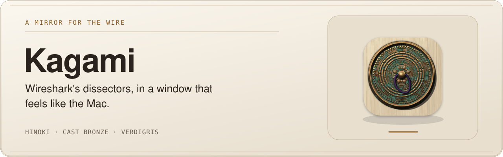
</picture>

**A mirror for the wire.** A native Mac packet viewer on Wireshark's own dissectors, that draws
every packet the way the RFCs do.


</div>

<br>

<picture>
  <source media="(prefers-color-scheme: dark)" srcset="docs/screenshots/main-dark.webp">
  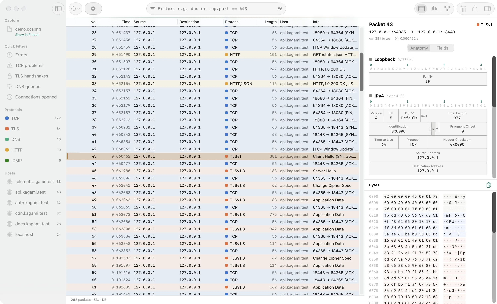
</picture>

<p align="center"><sub>A TLS Client Hello, read layer by layer. Every capture in this README is synthetic: loopback and <code>*.kagami.test</code> only.</sub></p>

## Install

Download [the latest release](https://github.com/mostlygino/Kagami/releases/latest) (0.1.0 beta).
It needs macOS 26 on Apple silicon.

- **`Kagami-0.1.0.dmg`**: drag Kagami to Applications.
- **`Kagami-0.1.0.pkg`**: the Installer, which can also link the `kagami` command into
  `/usr/local/bin`.

Each file has a `.sig` from the release key, and `SHA256SUMS` lists them all. Kagami is not
notarised, so macOS blocks the first open: choose System Settings > Privacy & Security >
Open Anyway, once. Recording and opening captures need Wireshark; flow files don't.

## Why Kagami

- **Packets the way the RFCs draw them.** The Anatomy inspector lays every fixed-format header
  on a 32-bit ruler, one box per field sized by its bits, the decoded value inside, linked to
  the bytes in both directions.
- **Every protocol Wireshark knows.** Kagami runs Wireshark's `tshark` and `sharkd` as
  separate programs, so it reads what Wireshark reads; no Wireshark code is linked in.
- **Flow files in seconds.** nfdump, CSV, JSON and Zeek exports open straight into Flows, with
  no Wireshark needed. A 2.3 GB nfdump text export opens in about 5 seconds, and totals count
  every record, up to 5 million.
- **Keyboard first.** ⌘K searches actions, packets and hosts; filters validate as you type;
  native tabs keep captures side by side.
- **A CLI and an MCP server for Claude and other agents.** The same core answers as JSON on
  the command line and through 10 MCP tools. Live capture over MCP stays off until you allow it.

## Try it in 30 seconds

```sh
git clone https://github.com/mostlygino/Kagami.git && cd Kagami
open -a Kagami Demo/demo.pcapng        # a synthetic capture on loopback (needs Wireshark)
open -a Kagami Demo/demo.netflow.gz    # 4,000 synthetic flows, no Wireshark needed
/Applications/Kagami.app/Contents/Helpers/kagami anatomy Demo/demo.pcapng 4
```

Pick packet 43 and read a TLS Client Hello layer by layer, or press ⌘K and type `tls`.

---

<div align="center">

<picture>
  <source media="(max-width: 600px) and (prefers-color-scheme: dark)" srcset="docs/brand/readme-showcase-dark-mobile.svg">
  <source media="(max-width: 600px)" srcset="docs/brand/readme-showcase-light-mobile.svg">
  <source media="(prefers-color-scheme: dark)" srcset="docs/brand/readme-showcase-dark.svg">
  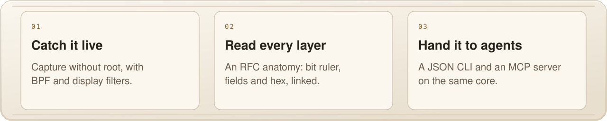
</picture>

<br><br>

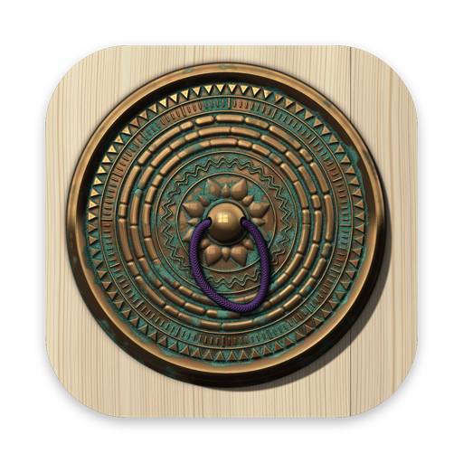

## Kagami · 鏡

A *kagami* is a mirror, and in Japan the bronze kind was never just for vanity: it showed
things as they are. Kagami does that for network traffic. Capture live or open a capture
file, narrow it down, and read one packet the way the RFCs draw it: a 32-bit ruler, every
field a box sized by its bits, the real value inside. Underneath is Wireshark's own dissector
engine, so every protocol Wireshark understands, Kagami shows. On top is a Mac app: native
tables, tabs, Liquid Glass, keyboard first. The same core also answers on the command line
and over MCP, so an agent can read a capture as well as you can.


<table>
<tr>
<td align="center"><b>3</b><br><sub>ways in: app, CLI, MCP</sub></td>
<td align="center"><b>10</b><br><sub>MCP tools</sub></td>
<td align="center"><b>1 px</b><br><sub>diagram rules, on device pixels</sub></td>
<td align="center"><b>41</b><br><sub>tests, plus CLI checks</sub></td>
<td align="center"><b>0</b><br><sub>root needed to capture</sub></td>
</tr>
</table>

</div>

---

## What it does

**Capture, or open a file.** Pick an interface on the start screen, where each one shows
its live activity, add a BPF capture filter if you like, and press Record (⌘R). No root:
Kagami uses Wireshark's ChmodBPF setup. Or open any capture Wireshark reads (pcap, pcapng,
snoop, ERF, PacketLogger, gzip, zstd or lz4 compressed) with ⌘O, drag and drop onto the window
or the Dock icon, or Finder's Open With. Native tabs (⌘T) keep several captures side by side.

**Narrow it down.** Wireshark display filters with live validation, a ⌘F filter builder for
when you don't remember the field name, quick filters in the sidebar (errors, TCP problems,
TLS handshakes, DNS, new connections), protocol and host groups, and Apply as Filter on any
field. Filters never touch the capture itself.

**Read one packet properly.** The Anatomy inspector draws each fixed-format header the way
RFC 791 and friends draw it: a 32-bit ruler, one box per field, sized by its bits, with the
decoded value inside. Select a field and its bytes light up in the hex view, and the other
way round. The Fields tab keeps Wireshark's full protocol tree.

**Follow the conversation.** Follow TCP or UDP Stream (⇧⌘F) shows the exchange as a ladder,
client on one side and server on the other, every payload with its frame number. Click a
frame number to find it in the table. Text or hex, search with match count.

**Compare and overview.** Diff two packets field by field or byte by byte, side by side or
unified, and step through only the differences. The Overview draws throughput by protocol,
the share of each protocol, TCP health (retransmissions, resets, zero windows), the busiest
hosts and service ports. The Endpoints window (⌥⌘E) lists every host and port.

**Flows.** Open a capture with NetFlow v5, v9 or IPFIX exports and Kagami reads the flow
records themselves: who talked to whom, how much, for how long, with TCP flags. A collector
preset sets up live collection. Flow files open straight into Flows: nfdump `nfcapd` files or a
folder of them (with `brew install nfdump`), CSV or TSV with a header (nfdump, pmacct, AWS VPC
flow logs, also gzipped), JSON or JSON lines (goflow2, pmacct, nfdump, Elastic ECS) and Zeek
`conn.log`, plus nfdump's own text output (`-o raw` and `-o line`, such as `.netflow` files).
Text exports stream with no size cap (a 2.3 GB file opens in about 5 seconds) and a file can
hold up to 5 million records; the table shows the first 100,000 by the current sort, while
totals and top talkers count every record. `kagami flows` and the MCP `list_flows` tool read
them too, without Wireshark.

Then drill down. The sidebar lists protocols, sources, destinations, service ports and
exporters as filters, and top talkers are clickable. Active filters sit as chips, with Copy
nfdump Filter to take the same view to the command line. The flow inspector shows one flow in
full plus the whole conversation between its two hosts, with buttons to narrow to a host, that
conversation or the port. A sortable Start column puts it all in order. In Flows the toolbar field searches flows (⌘L).

**Keep notes.** Packet comments (⌘L), highlights to mark what matters, and custom columns
for any field you want in the table.

**Take exactly what matters.** Export all, filtered or selected packets as pcapng or pcap (⇧⌘E).

<table>
<tr>
<td width="50%">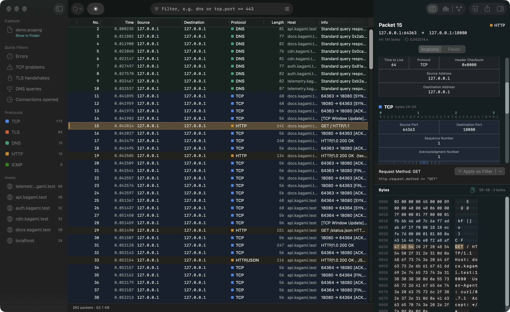<br><sub>Select a field: its box, its value and its bytes, linked.</sub></td>
<td width="50%">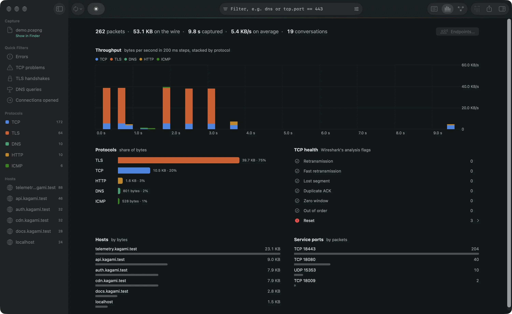<br><sub>The Overview: what is in this capture, at a glance.</sub></td>
</tr>
<tr>
<td width="50%">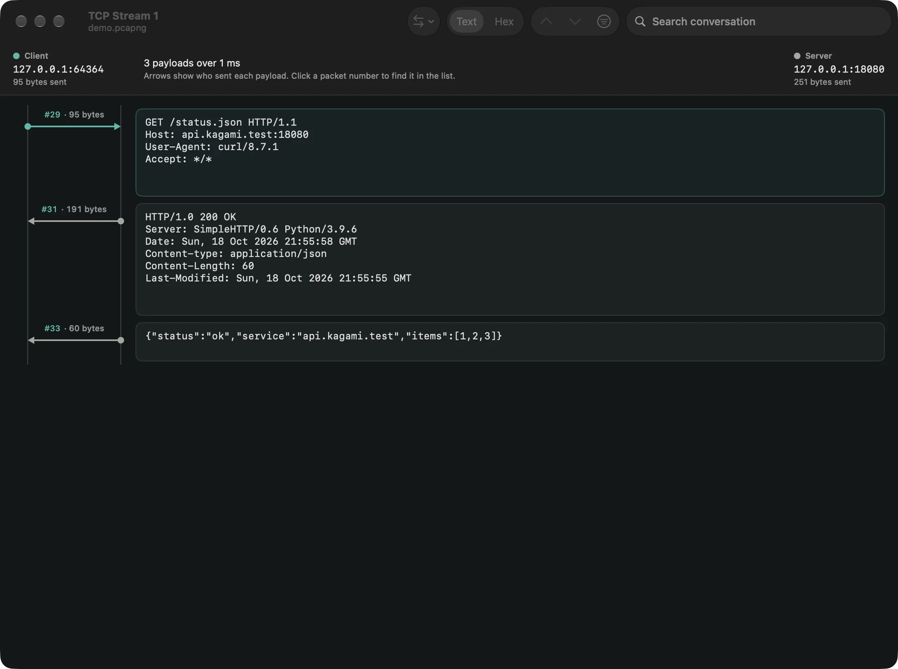<br><sub>Follow Stream as a ladder, with frame numbers you can click.</sub></td>
<td width="50%">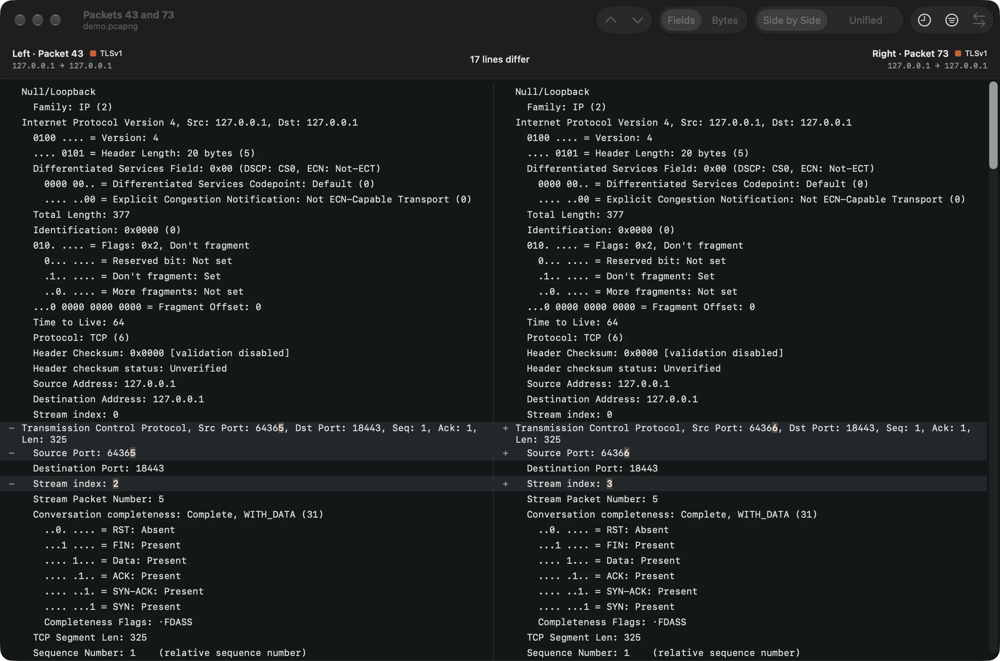<br><sub>Diff two packets, side by side or unified.</sub></td>
</tr>
<tr>
<td width="50%">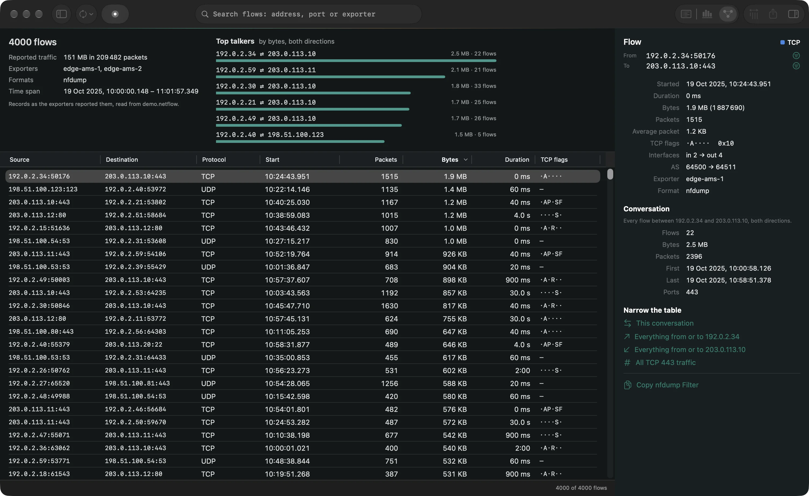<br><sub>Flows: NetFlow, IPFIX and flow files, with the flow inspector.</sub></td>
<td width="50%">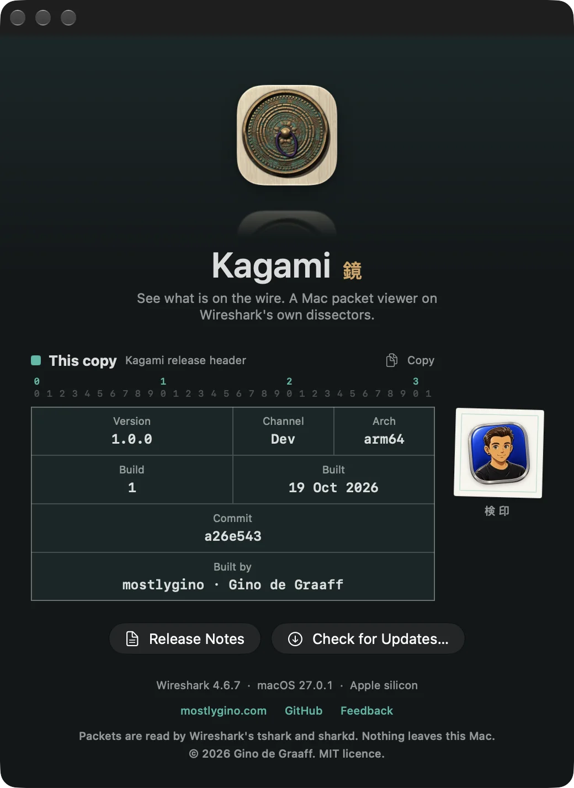<br><sub>About, with the exact build and commit for bug reports.</sub></td>
</tr>
</table>

## The same core, in a terminal and for agents

`kagami` ships inside the app (`Kagami.app/Contents/Helpers/kagami`). It speaks JSON on stdout
and returns meaningful exit codes, so it fits in scripts and CI.

```text
kagami interfaces
kagami capture -i <interface> [-d <seconds>] [-c <count>] [-f <bpf>] [-w <out.pcapng>]
kagami packets <file> [--filter <display filter>] [--offset N] [--limit N]
kagami packet <file> <frame> [--bytes] [--text]
kagami anatomy <file> <frame>                 RFC-style header diagrams, as text
kagami follow <file> <stream> [--udp] [--format text|hex|base64]
kagami flows <file>
kagami stats <file> [--filter <display filter>]
kagami export <file> -o <out> [--filter <display filter>] [--pcap]
kagami check <display filter>
kagami mcp                                     MCP server on stdio
```

`kagami anatomy` draws the same diagrams as the app, in plain text. This is a real run on the
demo capture:

```text
$ kagami anatomy Demo/demo.pcapng 4
IPv4 (bytes 4–23)
 0                   1                   2                   3
 0 1 2 3 4 5 6 7 8 9 0 1 2 3 4 5 6 7 8 9 0 1 2 3 4 5 6 7 8 9 0 1
+-+-+-+-+-+-+-+-+-+-+-+-+-+-+-+-+-+-+-+-+-+-+-+-+-+-+-+-+-+-+-+-+
| Ver=4 | IHL=5 |   DSCP    |ECN|       Total Length: 78        |
+-+-+-+-+-+-+-+-+-+-+-+-+-+-+-+-+-+-+-+-+-+-+-+-+-+-+-+-+-+-+-+-+
|    Identification: 0x4003     |R|D|M|   Fragment Offset: 0    |
+-+-+-+-+-+-+-+-+-+-+-+-+-+-+-+-+-+-+-+-+-+-+-+-+-+-+-+-+-+-+-+-+
|    TTL=64     | Protocol: UDP |    Header Checksum: 0x0000    |
+-+-+-+-+-+-+-+-+-+-+-+-+-+-+-+-+-+-+-+-+-+-+-+-+-+-+-+-+-+-+-+-+
|                   Source Address: 127.0.0.1                   |
+-+-+-+-+-+-+-+-+-+-+-+-+-+-+-+-+-+-+-+-+-+-+-+-+-+-+-+-+-+-+-+-+
|                Destination Address: 127.0.0.1                 |
+-+-+-+-+-+-+-+-+-+-+-+-+-+-+-+-+-+-+-+-+-+-+-+-+-+-+-+-+-+-+-+-+
```

`kagami mcp` serves the same abilities to Claude Code or any MCP client: list interfaces,
capture statistics, list packets, packet detail, packet anatomy, follow a stream, list flows,
check a filter, export packets, and capture. It is careful by default:

- **Capture is opt-in.** The capture tool only works when you start the server with
  `KAGAMI_MCP_ALLOW_CAPTURE=1`.
- **Writes stay in one folder.** Exports go to `~/Documents/Kagami` (or
  `KAGAMI_MCP_OUTPUT_DIR`) and never overwrite.
- **Payloads are marked untrusted.** Reassembled stream text is framed as data, not
  instructions, and every response has a size cap.

```sh
claude mcp add kagami -- /Applications/Kagami.app/Contents/Helpers/kagami mcp
```

## How it works

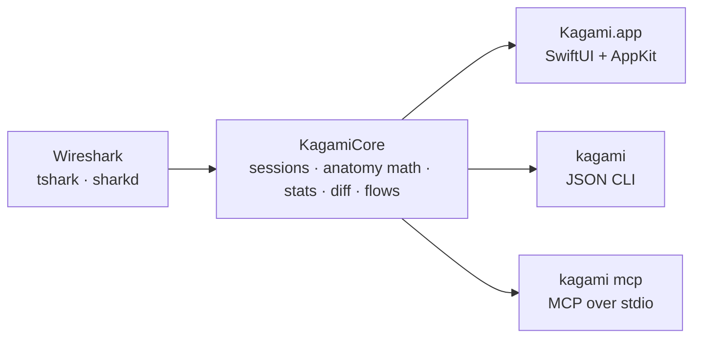

| Path | What |
|---|---|
| `Sources/KagamiCore/` | The engine: a persistent `sharkd` session (detail, filter checks, byte ranges) with `tshark` for capture, the RFC anatomy layout, statistics, diff, flows, the process map |
| `Sources/KagamiApp/` | The Mac app: packet table on `NSTableView`, inspector, follow ladder, diff, overview, flows, endpoints, settings, updater |
| `Sources/KagamiCLI/` | `kagami`: the JSON CLI and the MCP server |
| `Tests/KagamiTests/` | Swift Testing suite on synthetic fixtures |
| `scripts/` | `check-cli.sh`, `install.sh`, `release.sh`, `make-demo-capture.sh`, `make-icon.swift` |

Kagami runs Wireshark as a separate program and links none of its code.

## Build from source

**Needs:** macOS 26 or later, Xcode (SwiftUI macros need the full toolchain), and Wireshark
(`/Applications/Wireshark.app`, or `tshark` from Homebrew). Capturing without root needs
Wireshark's ChmodBPF, which its installer offers.

```sh
./make-app.sh            # builds build/Kagami.app, with the kagami CLI inside
scripts/install.sh       # or build and install into /Applications, where updates can reach it
open build/Kagami.app
```

```sh
swift test               # 41 tests on synthetic captures and flow files
scripts/check-cli.sh     # CLI and MCP: exit codes, JSON, protocol errors, write confinement
```

Try it on the demo capture: `open -a build/Kagami.app Demo/demo.pcapng`.

## Updates

Kagami updates itself from this repository's GitHub releases, read through GitHub's public
API, and verifies every download against a pinned release key before installing, so GnuPG is
needed for the check (`brew install gnupg`). While a repository is private it goes through the
`gh` CLI and its login instead; the app never stores a token. A daily check runs in the background; Kagami > Check for Updates… runs one now.
Releases are cut with `scripts/release.sh <version> [--beta]` and signed on a YubiKey, which
puts the DMG, the installer package and the zip the updater uses on the release, each with its
signature. 0.1.0 is the first public beta; see the [changelog](CHANGELOG.md). [SECURITY](SECURITY.md)
shows how to verify a download yourself.

## Privacy

Everything happens on this Mac. Kagami sends no telemetry and has no server. Captures you
open stay where they are; nothing leaves unless you export it. The demo capture and the test
fixtures are synthetic (loopback, documentation address ranges, `*.kagami.test`,
`example.com`): never commit a real capture.

## Contributing

Bug reports, ideas and pull requests are welcome. [CONTRIBUTING](CONTRIBUTING.md) covers the
build, the tests and how the code is laid out; the [code of conduct](CODE_OF_CONDUCT.md)
applies everywhere. Found a security problem? Please report it privately, as
[SECURITY](SECURITY.md) describes, not in an issue.

## Licence

Code: AGPL-3.0-or-later ([LICENSE](LICENSE)). Name, icon and artwork: all rights reserved, see [BRAND.md](BRAND.md).

## Read more

- [Design](DESIGN.md): the RFC Header Diagram direction, the protocol colour code, the rules it keeps
- [Product](PRODUCT.md): who Kagami is for and what success looks like
- [Brand](docs/brand/README.md): the Kyōhai icon and its alternates, rendered rather than drawn

<p align="center"><b>If Kagami helps you, a ⭐ helps others find it.</b></p>

---

<div align="center">

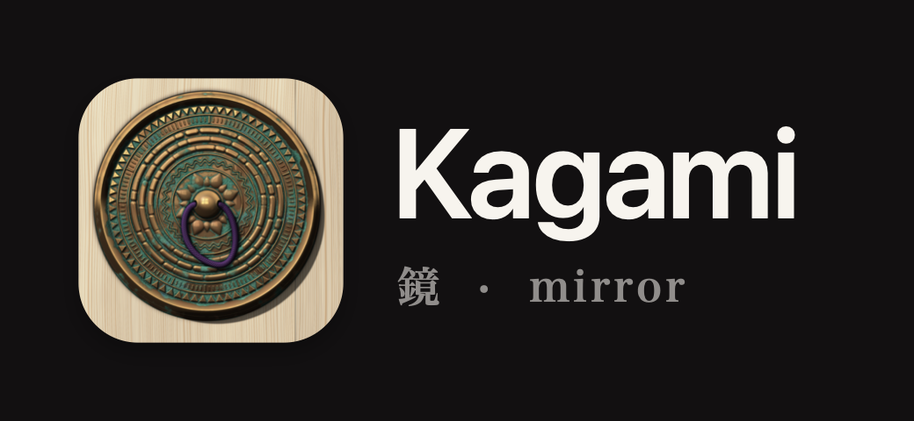

<sub>Built on <a href="https://www.wireshark.org">Wireshark</a>, which does every bit of the dissection (GPL v2+, run as a separate program).<br>
Code under AGPL-3.0-or-later; name, icon and artwork reserved. See <a href="#licence">Licence</a>.</sub>

</div>

<br>

<a href="https://mostlygino.com">
  <picture>
    <source media="(max-width: 600px) and (prefers-color-scheme: dark)" srcset="https://raw.githubusercontent.com/mostlygino/mostlygino/main/assets/signoff/built-with-love-dark-mobile.svg">
    <source media="(max-width: 600px)" srcset="https://raw.githubusercontent.com/mostlygino/mostlygino/main/assets/signoff/built-with-love-light-mobile.svg">
    <source media="(prefers-color-scheme: dark)" srcset="https://raw.githubusercontent.com/mostlygino/mostlygino/main/assets/signoff/built-with-love-dark.svg">
    
  </picture>
</a>
