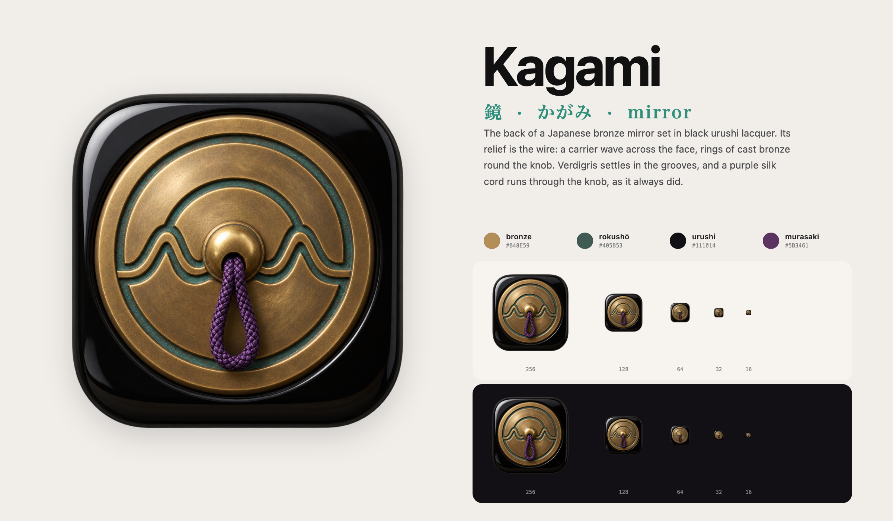
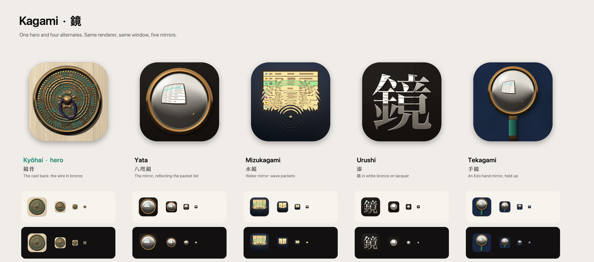

# Kagami brand

**Kagami helps Mac developers and security people see what is on the wire, represented by the cast back of a Japanese bronze mirror whose relief is the wire itself.**



## The hero: Kyōhai (鏡背)

The back of a bronze mirror lying on a hinoki board. Japanese mirrors carry their decoration on the back, and this one is cast like the sankakuen mirrors from the kofun: a knob with a silk cord through it, a lotus seat, bands of relief, a sawtooth ring and a rim of triangular section. The bands are the wire:

- a carrier wave (two lines in step, the fukusen hamon band);
- three tracks of packets, cast as cartouches of varying length;
- a comb band (kushimemon) that is a bit ruler: 128 teeth, every eighth one longer, a byte.

| Decision | Choice |
|---|---|
| Meaning | Kagami is a mirror. Its back shows what the app does: the wire laid out in order, every packet and every byte, cast in bronze |
| Silhouette | A round bronze disc on pale wood, a knob in the centre. It still reads at 16 px |
| Materials | Cast bronze (dominant), verdigris crust, hinoki edge grain. The silk cord is the one accent |
| Colour | Rubbed bronze and rokushō (verdigris), the product colour. Murasaki only for the cord |
| Signature detail | The comb band is a bit ruler with byte ticks, and a kumihimo cord through the knob casts its shadow on the relief |

Material notes, in the order they were built:

- **Wear tells the story.** The rim's ridge and the knob are rubbed back to gold, where hands held it. So is anything that stands proud. Verdigris grows where the relief shelters it and crusts over (it has its own grain and height), with the odd blue of azurite and a fringe of red cuprite.
- **The casting has thickness.** Seen a touch from above, its edge shows as a band of wall. The shadows are marched toward the window over the real height field, so the cord, the knob and every ridge cast their own.
- **Hinoki edge grain (masame).** Every growth line has its own width and depth, there are fibres along the grain, and two boards meet at a seam behind the mirror.
- **The knob's catchlight is the shoji.** The same window that lights everything shows in the knob as a lit pane with its cross of kumiko.

Tokens: bronze `#C8955A`, rokushō `#2F8F7A`, hinoki `#F3E0C1`, murasaki `#4E2D63`.

Detail by size: 256 px and up get everything (cord, wave, comb ruler, sixteen petals, crust grain). 128 px keeps the knob, eight petals, two packet tracks and a coarser sawtooth. 64 px and below keep a bigger knob, one broad band and the rim, with verdigris that is bolder so the colour survives.

## Alternates



| Variant | Object | Note |
|---|---|---|
| `yata` 八咫鏡 | The mirror's face on black lacquer: convex white bronze in a cast rim | The first hero. The reflection is a shoji window whose panes are a packet list, bent by the convex face |
| `mizu` 水鏡 | Still water at night. A drop sends out rings | The rings are wave packets, literally, and they break the lit window into its rows. The boldest option |
| `urushi` 漆 | 鏡 inlaid in white bronze on black lacquer | The most graphic option. Below 128 px the 16 strokes close up, so the inlay becomes a disc |
| `tekagami` 手鏡 | An Edo hand mirror, upright, with a silk cord grip on indigo cloth | Held up to look into. Round with a handle, so it sits closest to a magnifier: the weakest of the five |

## How it is made

**Since 2026-10-21 the app icon is a generated image**, not this renderer's output: the Kyōhai mirror back from [PROMPT.md](PROMPT.md), rendered with an image generator to the standard of Onmitsu and Kuro. `kagami-icon-master.png` is the original, `kagami-icon.png` the same object fitted to an 860 px body on a 1024 canvas, which feeds `Resources/AppIcon.icns`. The renderer below still makes the option sheets; the brand sheet and both lockups come from `brand_sheet.py` (text and colours in `brand-sheet.json`, laid out like the renderer's sheet, drawn by headless Chromium).

`scripts/make-icon.swift` is a small height-field renderer (about 2 s for the whole icon set), the same approach as Shīru's icon. Every surface is a height field lit by one window high to the left. Metal, lacquer and water reflect an analytic room (the shoji window, a dim wall, a paper lamp low on the right), so the reflection bends with the surface by itself. Nothing is drawn as a gradient. No SF Symbols are used, and no font is shipped: 鏡 is rasterised from the Hiragino Mincho outline.

Detail follows the slot size in every variant (for Kyōhai, see above). Every size renders at twice its slot and is scaled down.

```sh
swiftc -O scripts/make-icon.swift -o /tmp/kagami-icon
/tmp/kagami-icon /tmp/AppIcon.iconset --brand docs/brand        # kyohai by default; --variant yata etc. to switch
iconutil -c icns /tmp/AppIcon.iconset -o Resources/AppIcon.icns
./make-app.sh                                                   # copies the icns into the bundle
```

Files: `kagami-icon-<variant>.png` (1024 masters, one per variant), `kagami-brand-sheet.png`, `kagami-alternates.png`, `kagami-lockup.png`, `kagami-lockup-dark.png`. Shared craft standard: [APP_DESIGN.md](../design/APP_DESIGN.md).

The Kagami name, the icon and everything in this folder are reserved and not covered by the code licence; see [BRAND.md](../../BRAND.md).
